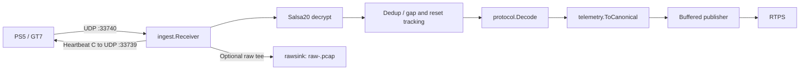

<div align="center">

<a href="https://arush-sal.github.io/gt7-telemetry-collector/"></a>

<h1>gt7-telemetry-collector</h1>
<p>From PS5 UDP packets to canonical telemetry frames, ready for RTPS.</p>

[](go.mod)
[](https://github.com/arush-sal/gt7-telemetry-collector/actions/workflows/test.yml)
[](https://github.com/arush-sal/gt7-telemetry-collector/actions/workflows/security.yml)
[](https://github.com/arush-sal/gt7-telemetry-collector/actions/workflows/release.yml)
[](https://arush-sal.github.io/gt7-telemetry-collector/)
[](LICENSE)
[](https://pkg.go.dev/github.com/arush-sal/gt7-telemetry-collector)

<a href="https://arush-sal.github.io/gt7-telemetry-collector/docs/">Documentation</a> &middot;
<a href="#install">Install</a> &middot;
<a href="#quick-start">Quick start</a> &middot;
<a href="#how-it-works">How it works</a> &middot;
<a href="#packages">Packages</a> &middot;
<a href="#raw-packet-dumps-pcap">Raw packet dumps</a> &middot;
<a href="#transports">Transports</a> &middot;
<a href="#faq">FAQ</a> &middot;
<a href="#license">License</a>

</div>

A standalone Go collector and reusable library for Gran Turismo 7 telemetry.
Receive encrypted packets from a PS5, decrypt and deduplicate them, and stream
canonical protobuf frames to a Real Time Processing System (RTPS) over gRPC,
a Unix stream socket, or HTTP(S).
Optional raw dumps preserve received bytes for debugging and offline analysis.

Documentation uses [Hugo + Hextra](https://arush-sal.github.io/gt7-telemetry-collector/).
See the [contributor guide](https://arush-sal.github.io/gt7-telemetry-collector/docs/contributing/) to build it locally.

## Install

Prebuilt binaries for linux, macOS and windows (amd64, arm64) are attached to
each [GitHub Release](https://github.com/arush-sal/gt7-telemetry-collector/releases),
with `checksums.txt`, an SBOM per archive, and Sigstore bundles. Or build from
source with Go:

```sh
go install github.com/arush-sal/gt7-telemetry-collector/cmd/gt7-collector@latest
gt7-collector --version
```

### Verify a release

Download an artifact `X` and its `X.sigstore.json` bundle, then check the
keyless signature and the SLSA build provenance:

```sh
cosign verify-blob --bundle X.sigstore.json \
  --certificate-identity-regexp '^https://github\.com/arush-sal/gt7-telemetry-collector/\.github/workflows/release\.yml@refs/tags/v.*$' \
  --certificate-oidc-issuer https://token.actions.githubusercontent.com X

gh attestation verify X --repo arush-sal/gt7-telemetry-collector

sha256sum -c --ignore-missing checksums.txt
```

## Quick start

Install with **Go 1.27.4 or later**, as specified in [go.mod](go.mod). The badge
above shows the Go release series; the module requires patch version 1.27.4.

```sh
go install github.com/arush-sal/gt7-telemetry-collector/cmd/gt7-collector@latest
```

With GT7 running on your PS5 and an RTPS telemetry ingest service available:

```sh
gt7-collector --ps5=192.168.1.50 --rtps=localhost:50051
```

Allow inbound UDP on the receive port. Add `--rawdump-dir=./rawdump` to capture
raw packets. gRPC uses plaintext transport. `--help` lists every flag.

### Use as a library

Supply any publisher implementing `Publish(*telemetryv1.TelemetryFrame)`. This
complete example prints canonical frames locally; it does not connect to RTPS.
Printing runs inline and can block, so use a buffered publisher such as
`transport.Publisher` for sustained collection.

```go
package main

import (
    "context"
    "errors"
    "fmt"
    "log"
    "os/signal"
    "syscall"
    "time"

    telemetryv1 "github.com/arush-sal/gt7-telemetry-collector/gen/gt7/telemetry/v1"
    "github.com/arush-sal/gt7-telemetry-collector/ingest"
    "github.com/arush-sal/gt7-telemetry-collector/protocol"
)

type printer struct{}

func (printer) Publish(frame *telemetryv1.TelemetryFrame) {
    fmt.Println(frame)
}

func main() {
    ctx, stop := signal.NotifyContext(context.Background(), syscall.SIGINT, syscall.SIGTERM)
    defer stop()

    pipeline := ingest.NewPipeline(nil, printer{}) // nil disables raw dumping
    receiver, err := ingest.NewReceiver(
        protocol.RecvPort, protocol.SendPort, "192.168.1.50",
        time.Second, pipeline.Handle,
    )
    if err != nil { // constructor binds the socket; bind errors fail immediately
        log.Fatal(err)
    }
    if err := receiver.Run(ctx); err != nil && !errors.Is(err, context.Canceled) {
        log.Fatal(err)
    }
}
```

For a single encrypted payload, the lower-level API is
`protocol.Decrypt(enc []byte) ([]byte, error)` followed by
`protocol.Decode(dec []byte) (protocol.GT7DData, error)`:

```go
func decodePacket(enc []byte) (protocol.GT7DData, error) {
    plaintext, err := protocol.Decrypt(enc)
    if err != nil {
        return protocol.GT7DData{}, err
    }
    return protocol.Decode(plaintext)
}
```

The pipeline already performs both steps, plus deduplication and canonical
mapping. Do not decrypt packets before passing them to `pipeline.Handle`.

## How it works



The current [heartbeat implementation](protocol/heartbeat.go) sends **`"C"`** to
request the extended packet format. `"A"` selects the standard format but is not
the heartbeat this collector sends. [Protocol constants](protocol/constants.go)
define receive port **33740** and heartbeat destination port **33739**; CLI flags
can override the ports.

The receive path tees encrypted bytes before validation. The pipeline rejects
wrong-length or bad-magic packets, drops duplicates and small reorders, tracks
session resets and gaps, and maps accepted packets to canonical frames. The
publisher buffers frames, drops the oldest when full, and reconnects with backoff.

INFO counter snapshots appear every 10 seconds and after shutdown: `published`,
`valid`, `foreign`, `short`, `stale`, `resets`, `gaps`, `pub_dropped`, and
`raw_dropped`. `published` counts pipeline submissions, not server acknowledgments.

On SIGINT or SIGTERM, the receiver stops first, then the publisher is canceled,
then the raw sink drains and closes before final counters are logged. Queued
frames are not guaranteed delivery during shutdown. Exit codes are **0** for
cancellation, **1** for startup/runtime failures, and **2** for flag/config errors.

## Packages

All paths below are relative to `github.com/arush-sal/gt7-telemetry-collector`.

| Package | Purpose |
| --- | --- |
| [`protocol`](protocol) | Salsa20 decryption, validation, GT7 packet decoding, deduplication, and heartbeat payload. |
| [`telemetry`](telemetry) | Maps GT7 data and capture metadata to canonical protobuf frames. |
| [`ingest`](ingest) | UDP receiver and raw/decrypt/dedup/decode/map/publish pipeline. |
| [`transport`](transport) | Buffered gRPC, Unix socket, and HTTP(S) publisher with drop-oldest handling and reconnect/backoff. |
| [`rawsink`](rawsink) | Asynchronous, afero-backed raw packet dumps. |
| [`replay`](replay) | Opens pcap/pcapng captures and feeds UDP payloads to a handler with scaled pacing. |
| [`gt7data`](gt7data) | Car names, drivetrains, and reference-data lookups. |
| [`gen/gt7/telemetry/v1`](gen/gt7/telemetry/v1) | Generated protobuf messages and gRPC service bindings. |
| [`cmd/gt7-collector`](cmd/gt7-collector) | Standalone collector command. |
| [`gt7data/internal/gen`](gt7data/internal/gen) | Internal command that generates car reference data. |

## Flags

These are the flags implemented by [`parseFlags`](cmd/gt7-collector/main.go).

| Flag | Default | Meaning |
| --- | --- | --- |
| `--ps5` | Required | Literal PS5 IP address. |
| `--rtps` | `localhost:50051` | RTPS target: bare `host:port`, `grpc://`, `unix:///`, or HTTP(S) URL. |
| `--rtps-token` | Empty (uses `INGEST_TOKEN`) | Optional ingest bearer token; prefer the environment variable to keep it out of `ps`. |
| `--recv-port` | `33740` | Local UDP receive port; 1..65535. |
| `--send-port` | `33739` | Console UDP heartbeat destination port; 1..65535. |
| `--heartbeat` | `1s` | Positive heartbeat interval, in Go duration syntax. |
| `--rawdump-dir` | Empty (disabled) | Directory for the optional raw dump. |
| `--raw-buffer` | `1024` | Positive raw packet buffer depth. |
| `--pub-buffer` | `1024` | Positive outbound frame buffer depth; oldest frame dropped when full. |
| `--log-level` | `info` | `debug`, `info`, `warn`, or `error`. |

## Raw packet dumps (pcap)

Set `--rawdump-dir` to open one **`raw-<unix>.pcap`** file per run, where `<unix>`
is the startup Unix timestamp in seconds. The directory is created if needed.
Classic pcap with nanosecond timestamps makes dumps readable by Wireshark and
tcpdump, replayable through the [`replay`](replay) package and RTPS
`--replay-file`, and preserves the still-encrypted UDP wire bytes.

Each payload has synthetic Ethernet/IPv4/UDP headers: zero MAC addresses,
IPv4 TTL 64 with valid checksums, source PS5 IP and configured console send port,
and destination receiver IP and receive port. An unknown local IP is recorded as
`0.0.0.0`. These headers describe the configured endpoints, including for foreign
packets; they are synthesized, not captured from the network. IPv4 endpoints are
required when raw dumping is enabled.

### Why store encrypted bytes?

- **Lossless ground truth:** retained payloads preserve the original wire bytes,
  including data a decoder may not understand yet.
- **Rejected packets remain useful:** the raw tee runs before validation, so
  foreign, malformed, and truncated packets can be inspected too.
- **Encryption provides no secrecy here:** the fixed GT7 Salsa20 key is public
  and present in the protocol implementation. Storing ciphertext preserves the
  input; it does not hide data from someone who has the file.
- **Exercise the decrypt path:** offline tools can feed retained bytes through
  the same decryption and decoding functions used during live collection.

Raw dumping is buffered and best effort. Overflow increments `raw_dropped`; disk
write errors are logged. The receiver uses a 4096-byte datagram buffer, so larger
foreign datagrams may already be truncated by the read. Two starts in the same
directory within one second can reuse and truncate the same filename.

## Transports

The collector dials the consumer (push model). `--rtps` selects the transport:

| Target | Wire format |
| --- | --- |
| `localhost:50051` or `grpc://localhost:50051` | Plaintext gRPC `Telemetry.Ingest` client stream. |
| `unix:///absolute/path.sock` | Unix stream socket; four-byte big-endian payload length followed by protobuf bytes. |
| `http://host/path` or `https://host/path` | One long-lived streaming POST to the URL path, `Content-Type: application/x-ndjson`; one protojson frame per line. |

Set `INGEST_TOKEN` in the collector's environment to send an optional
bearer token without putting it in process arguments (`ps`). Alternatively, use
`--rtps-token`; a non-empty flag overrides the environment variable, while an
empty flag falls back to it. With neither set, no authentication header is sent.
The consumer must validate the token to reject unauthenticated telemetry.

HTTP(S) sends `Authorization: Bearer <token>` on the streaming POST. gRPC sends
`authorization: Bearer <token>` as per-RPC metadata on each `Ingest` stream.
The collector logs a startup warning when a token is used with `http://`,
`grpc://` (schemes are case-insensitive), or a bare `host:port`, because these
transports send it unencrypted.
Use HTTPS when the token must be encrypted in transit. Unix sockets ignore the
token and rely on socket file permissions; neither `unix:///path.sock` nor
`unix:/path.sock` triggers this warning.

HTTP(S) targets must not contain URL userinfo or any query string (including
an empty `?`); supply credentials with `--rtps-token`, `INGEST_TOKEN`, or
`WithToken` instead. Network tokens must follow RFC 6750 `b64token` syntax:
one or more ASCII letters, digits, or `-._~+/`, followed by optional `=` padding.
Whitespace is rejected, including leading or trailing whitespace.

Library callers can use `transport.New(target, bufSize, log,
transport.WithToken(token))`. Consumers can share `transport.AuthHeader`,
`transport.AuthMetadataKey`, and `transport.BearerPrefix` when validating requests.
The legacy `NewPublisher` API retains its gRPC dial options; use `New` for the
bearer-token option.

All transports share the bounded drop-oldest queue, reconnect/backoff, and one
warning per outage. Non-2xx HTTP responses trigger reconnect; redirects are not
followed. The consumer must read the streaming request body incrementally. For
Go HTTP/1 servers that respond before consuming the body, call
`http.NewResponseController(w).EnableFullDuplex()` before writing the response.
A completed HTTP response ends the stream. Frames already dequeued when a send
fails are not retried; delivery is best effort, without acknowledgments.

Consumers can reuse `transport.ReadFrame` and `transport.WriteFrame` for Unix
framing, or `transport.NewNDJSONDecoder(r).Next()` for HTTP. Each protobuf frame
and each NDJSON line is capped at `transport.MaxFrameSize` (4 MiB, excluding the
length prefix or newline).

For a Unix connection accepted by a consumer:

```go
func consume(conn net.Conn) error {
    defer conn.Close()
    for {
        frame, err := transport.ReadFrame(conn)
        if errors.Is(err, io.EOF) {
            return nil
        }
        if err != nil {
            return err
        }
        fmt.Println(frame.GetSequence())
    }
}
```

The snippet uses `net`, `errors`, `io`, `fmt`, and
`github.com/arush-sal/gt7-telemetry-collector/transport`.

## FAQ

### Is ingest authenticated?

Authentication is an optional bearer token. Configure it with
`INGEST_TOKEN` or `--rtps-token`, and configure the consumer to validate it.
Without a token, the collector sends no authentication. `unix://` relies on
socket permissions and ignores bearer tokens. CORS is not authentication.

### Does it need a PS5?

Live collection does. Offline processing can use a saved pcap or pcapng capture
through [`replay`](replay). Open it with `replay.Open(path)` and close the returned
`*replay.Source` when finished. Its method is:

```go
func (s *Source) Play(ctx context.Context, recvPort uint16, speed float64,
    handle func([]byte, time.Time)) error
```

For example, `source.Play(ctx, uint16(protocol.RecvPort), 1.0, pipeline.Handle)`
replays matching UDP payloads at their original cadence; `2.0` doubles the speed.
Build that pipeline with
`ingest.NewPipeline(nil, pub, ingest.WithSource(telemetryv1.Source_SOURCE_REPLAY))`;
frames are otherwise labelled `SOURCE_LIVE`.
Use `math.Inf(1)` for maximum-speed playback. The collector command has no replay
flag; use the library or RTPS `--replay-file`.

### Which ports and packet formats are used?

By default, telemetry arrives on UDP **33740** and heartbeats go to the console's
UDP **33739**. The receiver sends `"C"`, not `"A"`. Decryption recognizes formats
A, B, `~`, and C by packet length. Source comments mark A and C as verified against
real captures; B and `~` constants remain documented but unverified against real
fixtures. See [protocol constants](protocol/constants.go).

### Why are the raw dumps still encrypted?

They preserve the input to the whole protocol pipeline, including failed
packets, rather than just a decoded interpretation. See
[Raw packet dumps](#raw-packet-dumps-pcap) for the capture format and tradeoffs.

### Is this a clean-room reimplementation?

Yes. It is a clean-room Go implementation of the GT7 wire protocol. Only protocol
*facts* (ports, Salsa20 key and nonce derivation, magic, field offsets, the
heartbeat byte) were taken from public research; no code from GPL-licensed
implementations was copied or vendored.

## License

[Business Source License 1.1 (BSL 1.1)](LICENSE).

| Parameter | Value in LICENSE |
| --- | --- |
| Change Date | `2030-01-01` |
| Change License | GNU General Public License version 3.0 (GPLv3) |
| Additional Use Grant | None. |

See [LICENSE](LICENSE) for the full terms.
