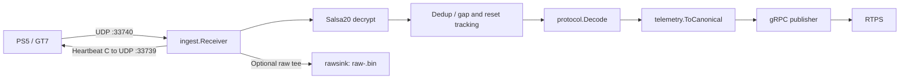

<div align="center">

<h1>gt7-telemetry-collector</h1>
<p>From PS5 UDP packets to canonical telemetry frames, ready for RTPS.</p>

[](go.mod)
[](LICENSE)
[](https://pkg.go.dev/github.com/arush-sal/gt7-telemetry-collector)

<a href="#quick-start">Quick start</a> &middot;
<a href="#how-it-works">How it works</a> &middot;
<a href="#packages">Packages</a> &middot;
<a href="#raw-packet-dumps">Raw packet dumps</a> &middot;
<a href="#faq">FAQ</a> &middot;
<a href="#license">License</a>

</div>

A standalone Go collector and reusable library for Gran Turismo 7 telemetry.
Receive encrypted packets from a PS5, decrypt and deduplicate them, and stream
canonical protobuf frames to a Real Time Processing System (RTPS) over gRPC.
Optional raw dumps preserve received bytes for debugging and offline analysis.

## Quick start

Install with **Go 1.26.3 or later**, as specified in [go.mod](go.mod). The badge
above shows the Go release series; the module requires patch version 1.26.3.

```sh
go install github.com/arush-sal/gt7-telemetry-collector/cmd/gt7-collector@latest
```

With GT7 running on your PS5 and an RTPS telemetry ingest service available:

```sh
gt7-collector --ps5=192.168.1.50 --rtps=localhost:50051
```

Allow inbound UDP on the receive port. Add `--rawdump-dir=./rawdump` to capture
raw packets. gRPC uses plaintext transport. `--help` lists every flag.

### Use as a library

Supply any publisher implementing `Publish(*telemetryv1.TelemetryFrame)`. This
complete example prints canonical frames locally; it does not connect to RTPS.
Printing runs inline and can block, so use a buffered publisher such as
`transport.Publisher` for sustained collection.

```go
package main

import (
    "context"
    "errors"
    "fmt"
    "log"
    "os/signal"
    "syscall"
    "time"

    telemetryv1 "github.com/arush-sal/gt7-telemetry-collector/gen/gt7/telemetry/v1"
    "github.com/arush-sal/gt7-telemetry-collector/ingest"
    "github.com/arush-sal/gt7-telemetry-collector/protocol"
)

type printer struct{}

func (printer) Publish(frame *telemetryv1.TelemetryFrame) {
    fmt.Println(frame)
}

func main() {
    ctx, stop := signal.NotifyContext(context.Background(), syscall.SIGINT, syscall.SIGTERM)
    defer stop()

    pipeline := ingest.NewPipeline(nil, printer{}) // nil disables raw dumping
    receiver, err := ingest.NewReceiver(
        protocol.RecvPort, protocol.SendPort, "192.168.1.50",
        time.Second, pipeline.Handle,
    )
    if err != nil { // constructor binds the socket; bind errors fail immediately
        log.Fatal(err)
    }
    if err := receiver.Run(ctx); err != nil && !errors.Is(err, context.Canceled) {
        log.Fatal(err)
    }
}
```

For a single encrypted payload, the lower-level API is
`protocol.Decrypt(enc []byte) ([]byte, error)` followed by
`protocol.Decode(dec []byte) (protocol.GT7DData, error)`:

```go
func decodePacket(enc []byte) (protocol.GT7DData, error) {
    plaintext, err := protocol.Decrypt(enc)
    if err != nil {
        return protocol.GT7DData{}, err
    }
    return protocol.Decode(plaintext)
}
```

The pipeline already performs both steps, plus deduplication and canonical
mapping. Do not decrypt packets before passing them to `pipeline.Handle`.

## How it works



The current [heartbeat implementation](protocol/heartbeat.go) sends **`"C"`** to
request the extended packet format. `"A"` selects the standard format but is not
the heartbeat this collector sends. [Protocol constants](protocol/constants.go)
define receive port **33740** and heartbeat destination port **33739**; CLI flags
can override the ports.

The receive path tees encrypted bytes before validation. The pipeline rejects
wrong-length or bad-magic packets, drops duplicates and small reorders, tracks
session resets and gaps, and maps accepted packets to canonical frames. The gRPC
publisher buffers frames, drops the oldest when full, and reconnects with backoff.

INFO counter snapshots appear every 10 seconds and after shutdown: `published`,
`valid`, `foreign`, `short`, `stale`, `resets`, `gaps`, `pub_dropped`, and
`raw_dropped`. `published` counts pipeline submissions, not server acknowledgments.

On SIGINT or SIGTERM, the receiver stops first, then the publisher is canceled,
then the raw sink drains and closes before final counters are logged. Queued gRPC
frames are not guaranteed delivery during shutdown. Exit codes are **0** for
cancellation, **1** for startup/runtime failures, and **2** for flag/config errors.

## Packages

All paths below are relative to `github.com/arush-sal/gt7-telemetry-collector`.

| Package | Purpose |
| --- | --- |
| [`protocol`](protocol) | Salsa20 decryption, validation, GT7 packet decoding, deduplication, and heartbeat payload. |
| [`telemetry`](telemetry) | Maps GT7 data and capture metadata to canonical protobuf frames. |
| [`ingest`](ingest) | UDP receiver and raw/decrypt/dedup/decode/map/publish pipeline. |
| [`transport`](transport) | Buffered gRPC publisher with drop-oldest handling and reconnect/backoff. |
| [`rawsink`](rawsink) | Asynchronous, afero-backed raw packet dumps. |
| [`replay`](replay) | Opens pcap/pcapng captures and feeds UDP payloads to a handler with scaled pacing. |
| [`gt7data`](gt7data) | Car names, drivetrains, and reference-data lookups. |
| [`gen/gt7/telemetry/v1`](gen/gt7/telemetry/v1) | Generated protobuf messages and gRPC service bindings. |
| [`cmd/gt7-collector`](cmd/gt7-collector) | Standalone collector command. |
| [`gt7data/internal/gen`](gt7data/internal/gen) | Internal command that generates car reference data. |

## Flags

These are the flags implemented by [`parseFlags`](cmd/gt7-collector/main.go).

| Flag | Default | Meaning |
| --- | --- | --- |
| `--ps5` | Required | Literal PS5 IP address. |
| `--rtps` | `localhost:50051` | RTPS gRPC ingest address. |
| `--recv-port` | `33740` | Local UDP receive port; 1..65535. |
| `--send-port` | `33739` | Console UDP heartbeat destination port; 1..65535. |
| `--heartbeat` | `1s` | Positive heartbeat interval, in Go duration syntax. |
| `--rawdump-dir` | Empty (disabled) | Directory for the optional raw dump. |
| `--raw-buffer` | `1024` | Positive raw packet buffer depth. |
| `--pub-buffer` | `1024` | Positive outbound frame buffer depth; oldest frame dropped when full. |
| `--log-level` | `info` | `debug`, `info`, `warn`, or `error`. |

Defaults match the GARAGE backend's collector configuration.

## Raw packet dumps

Set `--rawdump-dir` to open one **`raw-<unix>.bin`** file per run, where `<unix>` is
the startup Unix timestamp in seconds. The directory is created if needed. The
file has no global header; records repeat with no padding:

| Offset within record | Type | Contents |
| --- | --- | --- |
| `0` | `uint32`, little-endian | Payload length `N`, in bytes. |
| `4` | `int64`, little-endian | Receive timestamp, Unix nanoseconds. |
| `12` | `N` bytes | Encrypted UDP payload as received from the wire. |

The next record begins at offset `12 + N`. This is the format written by
[`rawsink.LocalSink`](rawsink/local.go).

### Why store encrypted bytes?

- **Lossless ground truth:** retained payloads preserve the original wire bytes,
  including data a decoder may not understand yet.
- **Rejected packets remain useful:** the raw tee runs before validation, so
  foreign, malformed, and truncated packets can be inspected too.
- **Encryption provides no secrecy here:** the fixed GT7 Salsa20 key is public
  and present in the protocol implementation. Storing ciphertext preserves the
  input; it does not hide data from someone who has the file.
- **Exercise the decrypt path:** offline tools can feed retained bytes through
  the same decryption and decoding functions used during live collection.

Raw dumping is buffered and best effort. Overflow increments `raw_dropped`; disk
write errors are logged. The receiver uses a 4096-byte datagram buffer, so larger
foreign datagrams may already be truncated by the read. Two starts in the same
directory within one second can reuse and truncate the same filename. The `replay`
package currently reads **pcap/pcapng**, not this `.bin` container.

## FAQ

### Does it need a PS5?

Live collection does. Offline processing can use a saved pcap or pcapng capture
through [`replay`](replay). Open it with `replay.Open(path)` and close the returned
`*replay.Source` when finished. Its method is:

```go
func (s *Source) Play(ctx context.Context, recvPort uint16, speed float64,
    handle func([]byte, time.Time)) error
```

For example, `source.Play(ctx, uint16(protocol.RecvPort), 1.0, pipeline.Handle)`
replays matching UDP payloads at their original cadence; `2.0` doubles the speed.
The command has no replay flag; replay is available through the library.

### Which ports and packet formats are used?

By default, telemetry arrives on UDP **33740** and heartbeats go to the console's
UDP **33739**. The receiver sends `"C"`, not `"A"`. Decryption recognizes formats
A, B, `~`, and C by packet length. Source comments mark A and C as verified against
real captures; B and `~` constants remain documented but unverified against real
fixtures. See [protocol constants](protocol/constants.go).

### Why are the raw dumps still encrypted?

They preserve the input to the whole protocol pipeline, including failed
packets, rather than just a decoded interpretation. See
[Raw packet dumps](#raw-packet-dumps) for the record layout and tradeoffs.

### Is this a clean-room reimplementation?

Yes. It is a clean-room Go implementation of the GT7 wire protocol. Only protocol
*facts* (ports, Salsa20 key and nonce derivation, magic, field offsets, the
heartbeat byte) were taken from public research; no code from GPL-licensed
implementations was copied or vendored.

## License

[Business Source License 1.1 (BSL 1.1)](LICENSE).

| Parameter | Value in LICENSE |
| --- | --- |
| Change Date | `2030-01-01` |
| Change License | GNU General Public License version 3.0 (GPLv3) |
| Additional Use Grant | None. |

See [LICENSE](LICENSE) for the full terms. The license text is identical to the GARAGE backend's.
