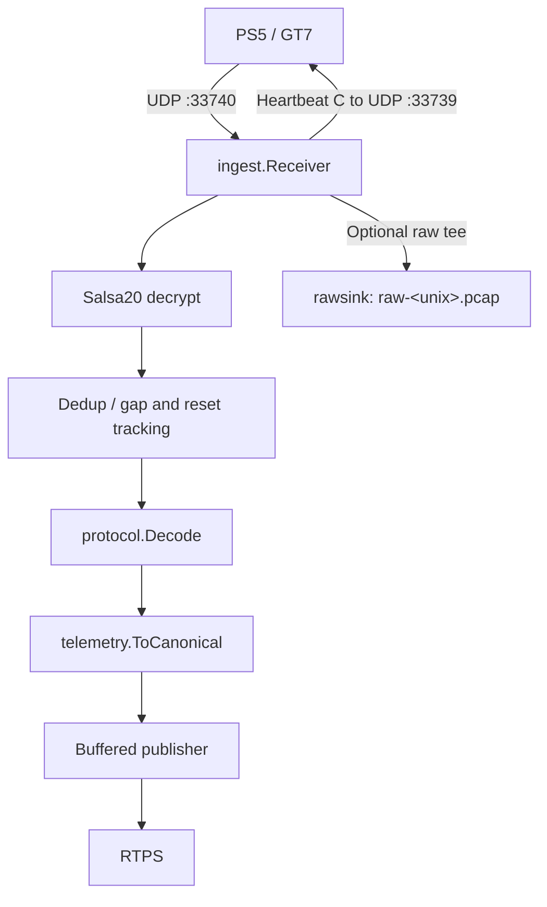

From PS5 UDP packets to canonical telemetry frames, ready for RTPS.

A standalone Go collector and reusable library for Gran Turismo 7 telemetry.
It receives encrypted packets from a PS5, decrypts and deduplicates them, and
streams canonical protobuf frames to a Real Time Processing System (RTPS) over
gRPC, a Unix stream socket, or HTTP(S). Optional raw dumps preserve the received
bytes for debugging and offline analysis.

## How it works



The receive path tees encrypted bytes before validation. The pipeline rejects
wrong-length or bad-magic packets, drops duplicates and small reorders, tracks
session resets and gaps, and maps accepted packets to canonical frames. The
publisher buffers frames, drops the oldest when full, and reconnects with
backoff.

INFO counter snapshots appear every 10 seconds and after shutdown: `published`,
`valid`, `foreign`, `short`, `stale`, `resets`, `gaps`, `pub_dropped`, and
`raw_dropped`. `published` counts pipeline submissions, not server
acknowledgments.

On SIGINT or SIGTERM the receiver stops first, then the publisher is canceled,
then the raw sink drains and closes before final counters are logged. Queued
frames are not guaranteed delivery during shutdown.

## Quick start

```sh
go install github.com/arush-sal/gt7-telemetry-collector/cmd/gt7-collector@latest
gt7-collector --ps5=192.168.1.50 --rtps=localhost:50051
```

Allow inbound UDP on the receive port. Add `--rawdump-dir=./rawdump` to capture
raw packets. gRPC uses plaintext transport. Does it need a PS5? Live collection
does; offline processing can replay a saved capture through the
[`replay`]() package.

## Quick links

- [Install](): release archives, `go install`, verifying releases
- [CLI reference](): every flag, defaults, exit codes
- [Transports](): gRPC, Unix socket and HTTP(S) wire formats
- [Library](): the Go packages and usage examples
- [Raw dumps](): the pcap format and replaying
- [Protocol](): reverse-engineered GT7 packet facts
- [Security](): tokens, plaintext warning, signed releases
- [Contributing](): dev setup, CI, releases, license
- [API reference on pkg.go.dev](https://pkg.go.dev/github.com/arush-sal/gt7-telemetry-collector)

This is a clean-room Go implementation of the GT7 wire protocol. Only protocol
facts (ports, Salsa20 key and nonce derivation, magic, field offsets, the
heartbeat byte) were taken from public research; no code from GPL-licensed
implementations was copied or vendored.
