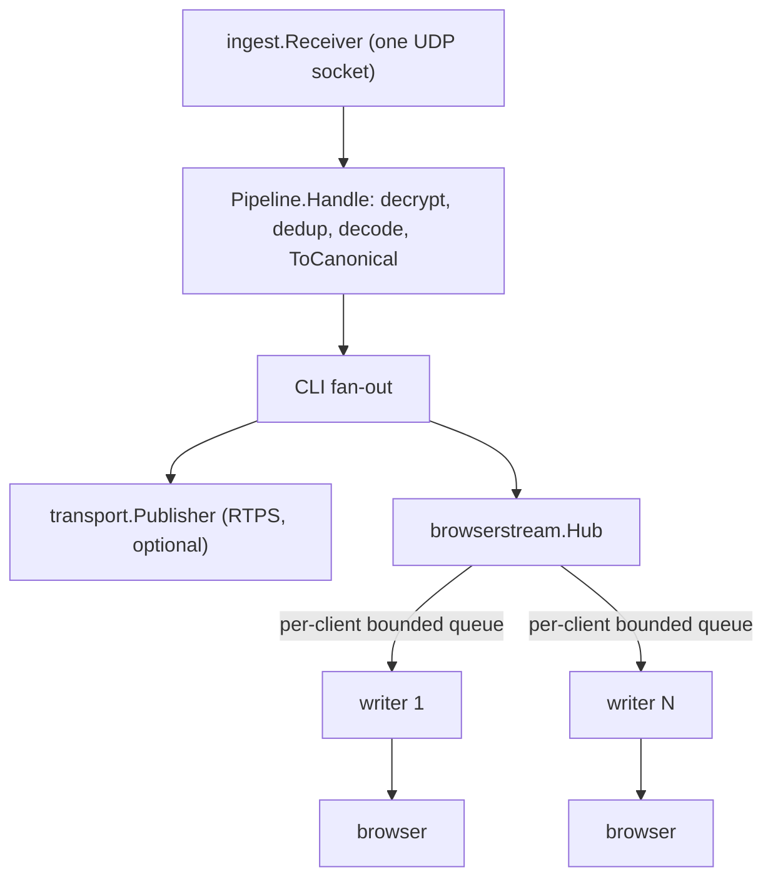

The collector can optionally serve live driver inputs (brake and throttle) to a
browser over a read-only WebSocket. Nothing is bound and nothing changes unless
you pass `--ws-listen`. The contract is `gt7.inputs.v1`; the design is recorded
in three ADRs:
[0001 sink architecture](https://github.com/arush-sal/gt7-telemetry-collector/blob/master/docs/adr/0001-optional-websocket-browser-sink.md),
[0002 input contract](https://github.com/arush-sal/gt7-telemetry-collector/blob/master/docs/adr/0002-browser-input-contract-v1.md) and
[0003 threat model](https://github.com/arush-sal/gt7-telemetry-collector/blob/master/docs/adr/0003-websocket-threat-model.md).


Live PS5 behaviour and every browser behaviour on this page (Local Network
Access prompts, mixed content, certificate handling) are **UNVERIFIED** until a
dated entry exists in the
[validation log](https://github.com/arush-sal/gt7-telemetry-collector/blob/master/docs/adr/validation-log.md).


## Architecture



- One receiver, one pipeline, one decode per packet. The browser stream is a
  second destination for the same canonical frame, not a second decode path.
- `Hub.Publish` runs on the receive goroutine and never blocks, allocates or
  does network I/O: it only enqueues the frame pointer into each client queue,
  dropping the oldest entry when full.
- Each client has its own writer goroutine that projects the frame to JSON and
  writes it with a deadline (`--ws-write-timeout`). A slow client overflows only
  its own queue; RTPS and other clients are unaffected.
- Modes: RTPS only (default, no listener), WS only (`--rtps=none --ws-listen=...`),
  or both. `--rtps=none` without `--ws-listen` is a configuration error (exit 2).
- Enabling the stream stores nothing. `--rawdump-dir` behaves exactly as before.

## Quick start

WS only, loopback, no token (any local process and any allowlisted origin can read):

```sh
gt7-collector --ps5=192.168.1.50 --rtps=none \
  --ws-listen=127.0.0.1:8765 --ws-origin=http://localhost:5173
```

RTPS and WS together, with a token:

```sh
export GT7_WS_TOKEN="$(openssl rand -hex 32)"
gt7-collector --ps5=192.168.1.50 --rtps=localhost:50051 \
  --ws-listen=127.0.0.1:8765 --ws-origin=https://trainer.example.com
```

Connect to `ws://127.0.0.1:8765/v1/stream` (or `wss://` with TLS). The browser
must send an allowlisted `Origin`, which it does automatically.

```js
// token is optional on loopback; never put it in the URL
const ws = new WebSocket("ws://127.0.0.1:8765/v1/stream",
  ["gt7.inputs.v1", "gt7.token." + token]);
ws.onmessage = (e) => {
  const m = JSON.parse(e.data);
  if (m.protocol !== "gt7.inputs.v1") return;
  if (m.type === "sample") {
    const seq = BigInt(m.sequence);           // sequence is a string
    // m.inputs.brake / m.inputs.throttle: percent 0..100, or null (no reading)
  }
};
```

Without a token, offer only `["gt7.inputs.v1"]`. Query-string tokens are not
read; `?token=` never authenticates.

## Protocol reference (`gt7.inputs.v1`)

JSON text frames, server to client only, one compact message per frame, no
compression. Every message has `type`, `protocol` (`"gt7.inputs.v1"`) and
`sessionId` (32 hex chars, random per collector process, not a credential).

### `hello` (first message on every connection)

| Field | Type | Notes |
| --- | --- | --- |
| `collectorVersion` | string | Collector build version (`dev` for local builds). |
| `canonicalSchemaVersion` | integer | Canonical protobuf schema version. |
| `capabilities.brake`, `.throttle` | object | `{available:true, unit:"percent", min:0, max:100}`. |
| `capabilities.steering` | object | `{available:false, reason:"driver_steering_input_unverified"}`. |
| `status` | string | `waiting_for_source`, `source_live` or `source_stale` at connect time. |

### `sample` (one per canonical frame delivered to this client)

| Field | Type | Notes |
| --- | --- | --- |
| `sequence` | string | Canonical sequence as a decimal string (exceeds 2^53). Parse with `BigInt`. |
| `packageId` | integer | GT7 package id (uint32). |
| `source` | string | `LIVE`, `REPLAY` or `UNSPECIFIED`, copied from the frame. |
| `recvTimestamp` | string | RFC 3339, UTC, `Z` suffix, 0-9 fractional digits (do not rely on digit count). |
| `sourceGap` | boolean | GT7 package id discontinuity: loss upstream of the collector. |
| `droppedSincePrevious` | integer | Samples lost inside the collector for this client since the previous sample sent to it. |
| `inputs.brake`, `inputs.throttle` | number or null | Percent 0..100, no smoothing. `null` means no reading, never 0. |
| `inputs.steering` | null | Always `null` in v1. |

Steering is unavailable: no canonical field is a verified driver steering
input. Only brake and throttle are transmitted. Invalid values (NaN, Inf or
outside 0..100) are sent as `null`, not clamped.

### `status` (per-connection source state change)

| Field | Values |
| --- | --- |
| `state` | `source_live` or `source_stale` |
| `reason` | `first_frame`, `source_resumed` (with `source_live`); `no_accepted_frames_within_timeout` (with `source_stale`) |

`--ws-source-timeout` (default 2s) sets the no-frame interval; detection takes
1x to 1.5x the timeout. The 2s default is provisional until live cadence and
paused/menu behaviour are measured (UNVERIFIED).

### Ordering guarantees

- `hello` is first, then only new frames; there is no backfill. A reconnect
  yields a new `hello`: do not stitch segments across connections.
- `source_stale` is sent ahead of queued samples, and queued samples at or
  below the stale point are discarded. No sample follows `source_stale` without
  an intervening `source_live`.
- Treat any `source_stale` as a segment break regardless of duration; a frame
  arriving right after it can produce `source_stale` immediately followed by
  `source_live`/`source_resumed`.
- `droppedSincePrevious` is `sequence - previousSent - 1` (0 for the first
  sample). It covers queue evictions, stale discards and projection failures.
  Loss after the last delivered sample is never reported.
- `sourceGap` (upstream loss) and `droppedSincePrevious` (collector loss) are
  independent.

### Close codes

| Code | Reason | Meaning |
| --- | --- | --- |
| 1001 | `collector_shutdown` | Collector stopping (also on token rotation restarts). |
| 1008 | `read_only_stream` | Client sent a data message. |
| 1009 | (library) | Client frame exceeded the 1 KiB read limit. |
| 4000 | `slow_consumer` | Write exceeded `--ws-write-timeout` (best effort; the socket may already be dead). |

### HTTP rejections (before upgrade)

A browser sees only close code 1006 for any of these; the status is visible in
devtools and to non-browser clients. Origin is checked first, then token.

| Status | Cause |
| --- | --- |
| 400 | Invalid `Sec-WebSocket-Protocol` (no or case-variant `gt7.inputs.v1`, more than one token entry, empty entries, more than 8 entries), or a request with a body. |
| 401 | Token required and missing or wrong. |
| 403 | `Origin` missing, `null`, unlisted, duplicated or comma-combined. |
| 405 | Method other than GET on `/v1/stream` or `/healthz`. |
| 421 | Loopback bind and `Host` is not a loopback IP literal or `localhost` (any path, including `/healthz`). |
| 431 | Oversized request headers (limit about 8 KiB; `net/http` adds a 4 KiB allowance). |
| 503 | `--ws-max-clients` reached (or the hub is shutting down). |

Other paths return 404. `GET /healthz` returns `200 {"status":"ok"}` with
`Cache-Control: no-store` and no other information.

### Versioning and fixtures

- Consumers ignore unknown fields, unknown `status` states and unknown message
  `type`, and reject any `protocol` other than `gt7.inputs.v1`.
- Removing a field or changing its meaning requires `gt7.inputs.v2`. A verified
  steering source would be an additive capability with new fixtures.
- The collector owns the contract. JSON Schema, valid and invalid fixtures and
  recorded stream transcripts live in
  [`browserstream/testdata/v1/`](https://github.com/arush-sal/gt7-telemetry-collector/tree/master/browserstream/testdata/v1).
  Consumers copy a tagged snapshot; there is no code dependency. The schema
  checks shape only: parse `sequence` as an arbitrary-precision integer.

## Security model summary

See [Security]() and ADR 0003.

- Loopback by default; a non-loopback bind needs `GT7_WS_TOKEN` plus TLS or
  `--ws-allow-insecure-lan`.
- Exact Origin allowlist (required), checked before upgrade. Browsers do not
  enforce same-origin policy on WebSockets, so this check is the control.
- Loopback binds reject foreign `Host` headers (DNS rebinding).
- Token only through the subprotocol; it is never echoed, logged or accepted in
  the URL.
- Read-only stream with bounded headers, clients, queues and write time.

## Operations and troubleshooting

Counters appear in the 10 second INFO stats line and the final line:
`ws_clients`, `ws_accepted`, `ws_rejected_origin`, `ws_rejected_token`,
`ws_rejected_subprotocol`, `ws_rejected_capacity`, `ws_rejected_host`,
`ws_sent`, `ws_dropped`, `ws_slow_closed`, `ws_invalid_inputs`,
`ws_stale_discarded`, `ws_source_state`. `pub_dropped` (RTPS) stays separate and
is omitted with `--rtps=none`. Individual rejections log at DEBUG (remote
address and reason only; run with `--log-level=debug`).

| Symptom | Likely cause and action |
| --- | --- |
| Hello says `waiting_for_source` or `source_stale` | No accepted GT7 packets: check `--ps5`, that GT7 is running, and inbound UDP on the receive port. Compare `valid` and `foreign` in the stats line. |
| Connection fails, nothing in the log | WS not enabled: `--ws-listen` is absent. Check `GET /healthz`. |
| Browser shows 1006 only | Wrong origin (403), wrong or missing token (401), bad subprotocol (400) or bad Host (421). Check the collector DEBUG log and `ws_rejected_*` counters, or devtools Network. |
| 401 | Token mismatch. Restart the collector with the new `GT7_WS_TOKEN`; update the page. |
| Browser blocks the request | Local Network Access permission denied, or mixed-content rules. See below. UNVERIFIED. |
| TLS error | Browsers do not trust self-signed certificates. Use a trusted certificate or a TLS-terminating proxy. |
| `source_stale` events | No frames for `--ws-source-timeout`. Normal when GT7 is paused or in menus (UNVERIFIED); raise the timeout if needed. |
| `droppedSincePrevious` greater than 0, `ws_dropped` growing | Client reads too slowly; raise `--ws-client-buffer` or fix the consumer. Other clients and RTPS are unaffected. |
| Close 4000 | Client missed a write deadline; see `ws_slow_closed`. |
| RTPS unreachable in dual mode | The RTPS publisher reconnects with backoff and warns once; the browser stream is unaffected. |
| Exit 1 at startup | `--ws-listen` port already in use, or TLS cert or key cannot be loaded. |
| Exit 2 at startup | Configuration error (see [CLI reference]()). |
| 503 | `--ws-max-clients` reached; close other tabs or raise the limit (max 64). |
| Close 1001 | Collector is shutting down (SIGINT or SIGTERM) or restarted. |

### HTTPS pages and local network access

A page served over HTTPS that connects to `ws://127.0.0.1` or a LAN address
involves mixed-content rules and, in Chrome, Local Network Access (LNA)
permission prompts. How each browser treats these for HTTPS origins is **not yet
verified**. Options, in order of least surprise: serve the trainer from
`http://localhost`; give the collector a trusted certificate (`--ws-tls-cert`,
`--ws-tls-key`) and use `wss://`; or terminate TLS in a reverse proxy.

### Ports and firewall

Default behaviour is loopback only, so no firewall change is needed. For a
non-loopback bind (`:8765`, `0.0.0.0`, `::`, or a LAN IP), allow inbound TCP on
that port from the intended hosts only, and set `GT7_WS_TOKEN`. Use `[::1]:8765`
for IPv6 loopback; `localhost` binds IPv4 only.

### Reverse proxy TLS

A proxy in front of a loopback bind must forward `Host: 127.0.0.1:<port>` (for
nginx, `proxy_set_header Host 127.0.0.1:8765;`) and pass `Origin` and
`Sec-WebSocket-Protocol` through unchanged. The proxy must not log
`Sec-WebSocket-Protocol`: it carries the token. The collector still enforces
Origin and token.

## Browser compatibility

All entries are **UNVERIFIED**. The
[validation log](https://github.com/arush-sal/gt7-telemetry-collector/blob/master/docs/adr/validation-log.md#browser-compatibility-matrix)
holds the matrix (Chrome, Firefox and Safari against loopback, LAN and `wss://`
targets, from HTTP and HTTPS pages). Also unverified: live PS5 packet cadence,
a full live brake sweep (fixtures contain one non-zero brake sample), and
paused/menu behaviour.

## Upgrade and rollback

- Upgrade is additive. Without `--ws-listen` the collector behaves as before.
- Rollback: remove every `--ws-*` flag and, if you used `--rtps=none`,
  restore an RTPS target (`--rtps=host:port`), then restart.
- `--rtps=none` is new. With it, `--rtps-token` is rejected and a set
  `INGEST_TOKEN` is ignored.
- Rotate the token by restarting with a new `GT7_WS_TOKEN`; clients close with
  1001 and must reconnect.

## Performance

Measured on one laptop (AMD Ryzen 7 PRO 5850U, Go 1.27.4; noisy, so treat as
order of magnitude). Adding the hub adds 0 allocations per packet.

| Benchmark | Result |
| --- | --- |
| `Pipeline.Handle`, no-op publisher | 1.16 us median |
| `Pipeline.Handle` with hub, 4 draining clients | 2.32 us median |
| `Hub.Publish` alone: 0 / 4 / 64 clients | 55 ns / 300-569 ns / 3.9-14.6 us, 0 allocs/op |

The extra cost is mostly waking each client writer goroutine. At 60 Hz the
4-client cost is about 0.003% of one core. Per-client JSON and network writes
run on writer goroutines, not the receive path. A sample is roughly 250-300
bytes (about 18 KB/s per client at 60 Hz).
